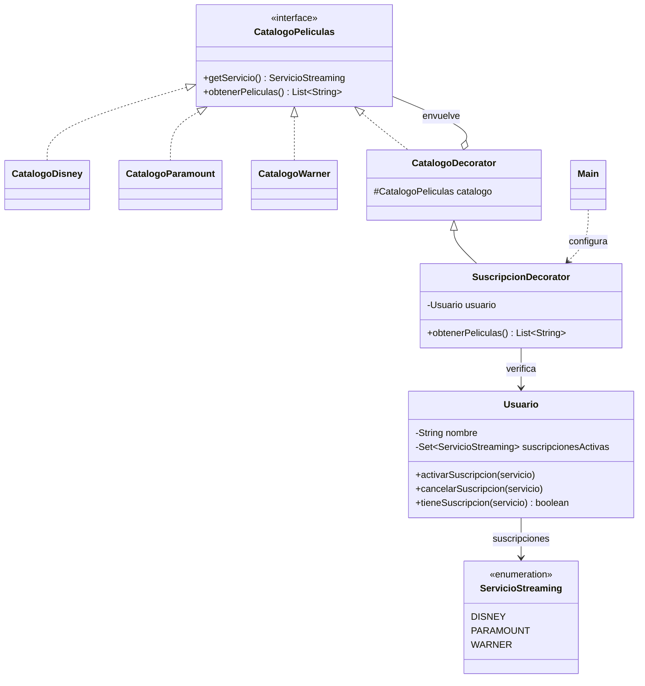

## El Patrón Decorator

### Contexto del Problema

Una plataforma ofrece catálogos de películas de Disney, Paramount y Warner. Cada usuario puede tener distintas suscripciones activas y solo debe consultar los catálogos incluidos en ellas.

Implementar toda la lógica de acceso dentro de cada catálogo mezcla responsabilidades. Crear una subclase diferente para cada combinación de catálogo y suscripción también produciría muchas clases. El patrón Decorator permite envolver un catálogo con una capa que verifica el acceso, manteniendo la misma interfaz.

### Tu Tarea: Controlar el acceso a catálogos con Decorator

El ejemplo Java de este directorio muestra una solución completa. Revisa las clases y sigue el flujo desde `Main`.

#### Instrucciones Paso a Paso:

1. **Define el componente:** `CatalogoPeliculas` declara las operaciones comunes para consultar el servicio y obtener sus películas.

   **Solución (`CatalogoPeliculas.java`):**
   ```java
   import java.util.List;

   public interface CatalogoPeliculas {
       ServicioStreaming getServicio();

       List<String> obtenerPeliculas();
   }
   ```

2. **Crea los componentes concretos:** `CatalogoDisney`, `CatalogoParamount` y `CatalogoWarner` implementan la interfaz y proporcionan sus películas.

   **Solución (`CatalogoDisney.java`):**
   ```java
   import java.util.List;

   public class CatalogoDisney implements CatalogoPeliculas {
       @Override
       public ServicioStreaming getServicio() {
           return ServicioStreaming.DISNEY;
       }

       @Override
       public List<String> obtenerPeliculas() {
           return List.of("El rey leon", "Toy Story", "Frozen");
       }
   }
   ```

   **Solución (`CatalogoParamount.java`):**
   ```java
   import java.util.List;

   public class CatalogoParamount implements CatalogoPeliculas {
       @Override
       public ServicioStreaming getServicio() {
           return ServicioStreaming.PARAMOUNT;
       }

       @Override
       public List<String> obtenerPeliculas() {
           return List.of("Top Gun: Maverick", "Sonic", "Un lugar en silencio");
       }
   }
   ```

   **Solución (`CatalogoWarner.java`):**
   ```java
   import java.util.List;

   public class CatalogoWarner implements CatalogoPeliculas {
       @Override
       public ServicioStreaming getServicio() {
           return ServicioStreaming.WARNER;
       }

       @Override
       public List<String> obtenerPeliculas() {
           return List.of("Harry Potter", "Batman", "Duna");
       }
   }
   ```

3. **Crea el decorador base:** `CatalogoDecorator` también implementa `CatalogoPeliculas`, conserva una referencia a otro catálogo y delega sus operaciones.

   **Solución (`CatalogoDecorator.java`):**
   ```java
   import java.util.List;

   public abstract class CatalogoDecorator implements CatalogoPeliculas {
       protected final CatalogoPeliculas catalogo;

       protected CatalogoDecorator(CatalogoPeliculas catalogo) {
           this.catalogo = catalogo;
       }

       @Override
       public ServicioStreaming getServicio() {
           return catalogo.getServicio();
       }

       @Override
       public List<String> obtenerPeliculas() {
           return catalogo.obtenerPeliculas();
       }
   }
   ```

4. **Añade la responsabilidad de suscripción:** `SuscripcionDecorator` envuelve un catálogo y un usuario. Antes de devolver las películas, comprueba que el usuario tenga activa la suscripción correspondiente. Si no la tiene, deniega el acceso.

   **Solución (`SuscripcionDecorator.java`):**
   ```java
   import java.util.List;

   public class SuscripcionDecorator extends CatalogoDecorator {
       private final Usuario usuario;

       public SuscripcionDecorator(CatalogoPeliculas catalogo, Usuario usuario) {
           super(catalogo);
           this.usuario = usuario;
       }

       @Override
       public List<String> obtenerPeliculas() {
           ServicioStreaming servicio = getServicio();
           if (!usuario.tieneSuscripcion(servicio)) {
               throw new IllegalStateException(
                       usuario.getNombre() + " no tiene activa la suscripcion de " + servicio.getNombre());
           }

           return super.obtenerPeliculas();
       }
   }
   ```

5. **Modela las suscripciones del usuario:** `Usuario` permite activar, cancelar y consultar suscripciones de Disney, Paramount y Warner.

   **Solución (`ServicioStreaming.java` y `Usuario.java`):**
   ```java
   public enum ServicioStreaming {
       DISNEY("Disney"),
       PARAMOUNT("Paramount"),
       WARNER("Warner");

       private final String nombre;

       ServicioStreaming(String nombre) {
           this.nombre = nombre;
       }

       public String getNombre() {
           return nombre;
       }
   }
   ```

   ```java
   import java.util.EnumSet;
   import java.util.Set;

   public class Usuario {
       private final String nombre;
       private final Set<ServicioStreaming> suscripcionesActivas = EnumSet.noneOf(ServicioStreaming.class);

       public Usuario(String nombre) {
           this.nombre = nombre;
       }

       public String getNombre() {
           return nombre;
       }

       public void activarSuscripcion(ServicioStreaming servicio) {
           suscripcionesActivas.add(servicio);
       }

       public void cancelarSuscripcion(ServicioStreaming servicio) {
           suscripcionesActivas.remove(servicio);
       }

       public boolean tieneSuscripcion(ServicioStreaming servicio) {
           return suscripcionesActivas.contains(servicio);
       }
   }
   ```


### Ejecutar el ejemplo

Desde este directorio, compila y ejecuta las clases:

```bash
javac *.java
java Main
```

El usuario de ejemplo tiene Disney y Warner activos, por lo que puede consultar esos catálogos. El intento de consultar Paramount es denegado. Al activar Paramount y volver a intentarlo, el acceso se permite.

### Pruebas

Ejecuta `Main` y verifica que:

* Una suscripción activa permite consultar las películas de ese servicio.
* Sin la suscripción correspondiente, se informa que el acceso fue denegado.
* Activar una suscripción cambia el resultado sin reemplazar el catálogo ni crear otra subclase.
* Los catálogos y el decorador se pueden usar mediante la misma interfaz `CatalogoPeliculas`.

#### Preguntas de Análisis:

- ¿Qué responsabilidad añade `SuscripcionDecorator` al catálogo que envuelve?

Añade el control de acceso. Los catálogos (CatalogoDisney, CatalogoParamount, CatalogoWarner) solo saben qué películas tienen. SuscripcionDecorator sobrescribe obtenerPeliculas() y, antes de delegar, pregunta a Usuario si tiene activa la suscripción del servicio (usuario.tieneSuscripcion(getServicio())). Si no la tiene, lanza una IllegalStateException. Si la tiene, llama a super.obtenerPeliculas() y devuelve la lista original sin modificarla. El catálogo no se entera de que está siendo “vigilado”.

- ¿Por qué `CatalogoDecorator` guarda una referencia de tipo `CatalogoPeliculas` y no de una clase concreta?

Porque el decorador solo depende de la interfaz, no de una implementación concreta. Esto permite:

Envolver cualquier catálogo (Disney, Paramount, Warner o uno nuevo) con la misma clase, sin cambiar el decorador.
Que el decorador sea a su vez un CatalogoPeliculas, así que el cliente lo usa igual que a un catálogo normal, sin saber si está decorado.
Apilar decoradores, porque un decorador puede envolver a otro (por ejemplo, uno de suscripción y luego uno de logging o de restricción por edad).

- ¿Qué ventaja tiene comprobar la suscripción al consultar el catálogo, en vez de generar una clase para cada combinación de suscripciones?

Evita la explosión de clases. Con 3 catálogos y las combinaciones de suscripción tendrías DisneyConSuscripcion, ParamountSinSuscripcion, etc., y cada servicio nuevo multiplicaría las clases. Con el decorador hay una sola clase de control que sirve para todos.
Es dinámico. La comprobación se hace en cada consulta contra el estado actual de Usuario. Si el usuario activa o cancela una suscripción, el resultado cambia sin reemplazar el catálogo ni crear otra subclase, como muestra el Main (se niega Paramount y, al activarlo, se permite).
Separa responsabilidades. Los catálogos solo manejan contenido y el decorador solo maneja acceso, así que cada cosa cambia por separado.
Se compone en tiempo de ejecución. Se decide al armar el objeto (new SuscripcionDecorator(new CatalogoDisney(), usuario)) en vez de en tiempo de compilación mediante herencia.

- ¿Qué cambiarías si un usuario pudiera acceder a varios catálogos con una única suscripción de paquete?

Cambiaría el modelo de quién decide si hay acceso, no la estructura del decorador. Lo que yo haría:

Pasar de “un servicio por suscripción” a “una suscripción cubre un conjunto de servicios”. Por ejemplo, un tipo Suscripcion (o enum Paquete) con un Set<ServicioStreaming> de servicios incluidos, y un método incluye(ServicioStreaming).
Mover la lógica de acceso a Usuario. tieneSuscripcion(servicio) pasaría a responder true si el servicio está activo de forma individual o lo cubre alguno de sus paquetes activos. Así SuscripcionDecorator casi no cambia: sigue preguntando usuario.tieneSuscripcion(getServicio()).
Mantener un decorador por catálogo. Cada catálogo seguiría envuelto por su propio SuscripcionDecorator, y todos consultarían al mismo Usuario.
Opcionalmente, un CatalogoCompuesto para consultar varios catálogos a la vez. Sería un patrón Composite que implementa CatalogoPeliculas, agrupa varios catálogos y junta sus películas. Se podría envolver con un solo decorador de paquete en vez de uno por catálogo.

## Diagrama de clases



---